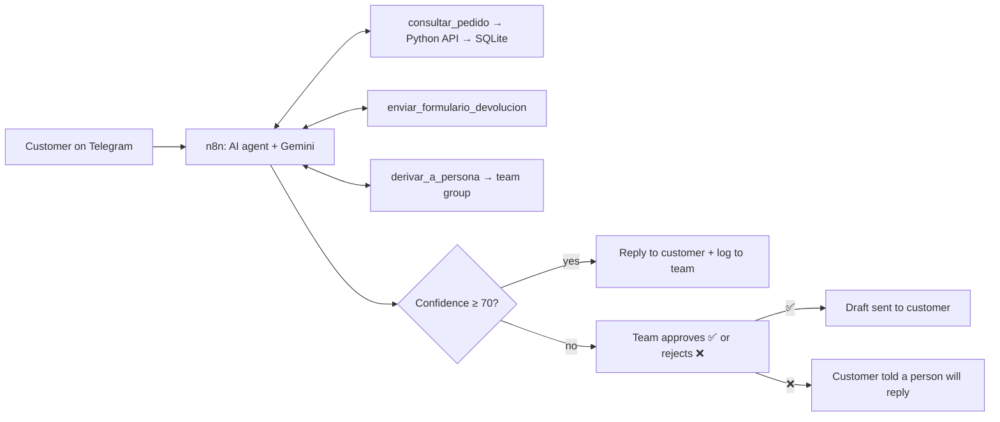

# Project 9 · AI agent on Telegram that uses tools (with human approval)

> ⚠️ **Fictional data.** It uses the same made-up orders as [project 6](../06-sql-ventas/), plus made-up shipping dates.

## The problem
Most customer messages to a small online shop are the same few questions: *where is my order?* and *can I return it?* Answering them means looking up the order, checking the return deadline and sending the right link, again and again. A chatbot that only *writes* text can't do that: it doesn't know the order, so it either can't answer or makes things up.

## The solution
An **AI agent**: a chatbot that doesn't just talk, but decides which **tool** to use, uses it, and then answers. Customers write to a Telegram bot from their phone. The agent (Google Gemini inside **n8n**) has three tools:

| Tool | What it does |
|---|---|
| `consultar_pedido` | Looks up the order in the database through a small Python API: products, status, delivery date and whether it can still be returned |
| `enviar_formulario_devolucion` | Sends the link to the returns form from [project 3](../03-n8n-devoluciones/) |
| `derivar_a_persona` | Hands the case over to the team's Telegram group |



### The transparent part
The team always sees (and, with `modo_demo` on, the customer too) a line saying **which tools the agent actually used, why, and how confident it is**:

> *(translated from Spanish)* Your order 2142 is within the 30-day return period, you can request the return here: https://…/form/…
> *— 🔧 consultar_pedido, enviar_formulario_devolucion · 💭 The order is within the return period · 🎯 confidence 100/100*

- **The tools** come from what the agent really did (n8n's intermediate steps), not from what it says it did.
- **The confidence is calculated by code, not by the AI.** During testing Gemini rated *every* answer 100/100, even when it was wrong, so the human approval never triggered. Now it starts at 100 and fixed risk signals subtract points:

| Risk signal | Points |
|---|---|
| The AI didn't return the expected format | −100 |
| The reply contains a link that isn't the returns form | −50 |
| A tool failed (an order that doesn't exist doesn't count) | −40 |
| The customer gave an order number and the agent didn't look it up | −40 |
| Money is involved (refund, discount, compensation…) | −40 |
| The reply promises a contact channel (email, Instagram, phone…) | −40 |

  Below **70**, the draft goes to the team group with ✅/❌ buttons and nothing reaches the customer until someone decides.
- **`modo_demo`** (in the `Config` node): when on, the customer also sees the transparency line (useful to show the project). When off, the customer only sees the answer. The team group always gets a 📋 log of each automatic reply.

### The business rules live in code
The **30-day return rule** is calculated by `api_pedidos.py`, not decided by the AI, so it's always applied the same way. The AI only reads the result (`dentro_plazo_devolucion: true/false`).

## Files
- **`crear_estados.py`**: invents a shipping and delivery date for each order (fixed random seed, so the result is always the same) and saves them in `estados.db`, without touching project 6.
- **`api_pedidos.py`**: a small local API (`http://127.0.0.1:8009/pedido?numero=1002`). It opens both databases **read-only**, only accepts digits as the order number, and only listens on this computer. Orders are from 2025, so it uses a **simulated "today" (2 January 2026)**: otherwise every order would be months past the deadline.
- **`flujo-agente-telegram.json`**: the n8n workflow (17 nodes).

## How to use it
You need n8n, Python 3, a Telegram bot (create it with @BotFather) and [cloudflared](https://developers.cloudflare.com/cloudflare-one/connections/connect-networks/). Telegram has to be able to reach your n8n, and a local n8n has no public address, so `cloudflared` opens a **temporary tunnel**: a public address that forwards to your computer.

```bash
python3 ../06-sql-ventas/cargar_bd.py   # only if ventas.db doesn't exist
python3 crear_estados.py
python3 api_pedidos.py                  # leave it running
```
```bash
cloudflared tunnel --url http://localhost:5678   # copy the https://….trycloudflare.com address
```
```bash
WEBHOOK_URL=https://YOUR-ADDRESS.trycloudflare.com/ npx -y n8n@2.47.5
```
Then, in n8n:
1. Import `flujo-agente-telegram.json`. Choose your Telegram credential (the bot token) in every Telegram node and your Gemini credential in the `Gemini` node.
2. Create a Telegram group for the team and add the bot. To get its ID: open `Telegram Trigger` → *Listen for test event*, write `/start@your_bot` in the group and copy `message.chat.id`.
3. In `Config`, fill in `formulario_url` (`https://YOUR-ADDRESS.trycloudflare.com/form/<id of the project 3 form>`) and `grupo_equipo_id`, and switch on `modo_demo` if you want to show the transparency line.
4. **Publish** this workflow and the project 3 workflow (so the form link works).

**Security:** while the tunnel is open, your n8n login page is reachable from the internet. Close it (Ctrl+C) when you're done. The quick tunnel address changes every time, so steps 3-4 have to be repeated.

## What happened when I tested it
I predicted the result before each test (messages translated from Spanish).

| Message | Prediction | Result |
|---|---|---|
| "Where is my order 2390?" | `consultar_pedido`, shipped, direct reply | ✅ As predicted |
| "I want to return order 2142" (delivered exactly 30 days ago) | `consultar_pedido` + form, link, nothing to the team | ✅ Link sent. ❌ The team did get the 📋 log |
| "I want to return order 2157" (31 days) | `consultar_pedido` + `derivar_a_persona`, explains why, log to the team | ✅ Right, but the team got **two** messages: the handover (decided by the agent) and the log (a fixed rule of the workflow) |
| "This is a disgrace, I want my money now" | Confidence 60 (money), team decides; after ❌, nothing | ✅ Confidence 60. ❌ The customer gets nothing until the team decides, and after ❌ the customer is told a person will reply |
| "Can you give me a discount on order 2390?" + ✅ | Confidence 60, reviewed draft | ✅ Reviewed draft. ❌ Confidence 20: two signals add up (money + order number not looked up) |

Bugs and design problems found along the way:
- **The agent didn't make anything up when a tool failed.** On the first test n8n couldn't reach the API. The agent told the customer it had technical problems and offered to pass the case to a person, instead of inventing an order status. (Cause: `localhost` was resolved to the IPv6 address, while the API only listens on `127.0.0.1`.)
- **Telegram rejected the replies** because it read the `_` in `consultar_pedido` as the start of italic text. Replies are now sent as HTML, with `< > &` escaped.
- **It handed everything over to a person**, even questions about the weather or who the CEO is. The rule was too broad. Now off-topic questions get a polite "I can only help with orders and returns", with no tools.
- **It promised things the shop may not do**, like contacting the customer on Instagram. That's now a risk signal (−40).
- **The AI was always 100% sure of itself**, so the confidence is now calculated by code.

## Known limitations
- The risk signals are simple word searches, so they can be wrong: "Correos" (the Spanish postal service) counts as promising an email, and a year like "2025" counts as an order number.
- If any item of an order was returned, the whole order shows as returned.
- Anyone who knows an order number can ask about it. A real shop would first check the customer's identity (for example, their email).

## Why I built it this way
- **Why a Telegram agent with tools and transparency:** I wanted to take a big step and dare to do something complex and eye-catching, something in demand that inspires me to do new projects.
- **Why a Python API:** I think it was to have fresh data, although I'm not sure.
- **Why the fictional clothing brand instead of real public data:** to continue the clothing brand's story and solve a problem that, although fictional, is real. With real data you don't solve anything that hasn't already been solved.
- **Why the customer doesn't see the transparency line by default:** if you're a customer, you shouldn't see that second paragraph. The `modo_demo` switch solves both of our problems.
- **Why it only hands over relevant questions:** the agent should only pass on questions that are relevant and pertinent to the company.
- **Why the confidence is calculated by code:** it's more reliable and explainable.
- **What I would change for a real company:** I would fine-tune which answers it can and can't give, and which ones it should hand over.

## What I learned
- I learned how to build a chatbot that answers customers' typical questions in real time.
