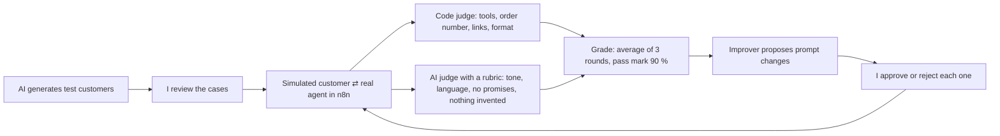

# Project 11 · An automatic examiner that tests and improves the AI agent

> ⚠️ **Fictional data.** The customers are simulated by AI and the orders are the made-up ones from [project 9](../09-agente-telegram/).

## The problem
The [project 9](../09-agente-telegram/) agent answers customers on Telegram. But how do you know it answers *well*? Testing it by hand means writing dozens of messages, reading every answer and repeating everything after each change. And an AI doesn't answer the same way twice, so one good test proves very little.

## The solution
An **examiner**: Python scripts that put the real agent through an exam, grade it and propose improvements. A person (me) approves or rejects each improvement.

- **Test customers generated by AI, reviewed by me.** Code chooses the real order for each case and decides what the agent *should* do (look up the order, send the returns form, hand over to a person…). The AI only invents the customer: age, tone, spelling mistakes. A code check rejects any case whose message doesn't contain its own order number (the AI once copied the wrong one).
- **A simulated customer** (Gemini) talks to the real agent for 2-4 turns and can go off-script, like real customers do.
- **Two judges.** Code checks what is objective (which tools were used, the right order number, only the returns-form link, valid JSON). An AI with a rubric checks what is subjective (tone, language, no promises, no invented data, whether handing over to a person was justified).
- **Three question banks.** **A** is used to improve the prompt. **B** is the final exam: the improver never sees it, so it can't memorise the answers. **C** has six *new* kinds of customer the agent had never seen (mixed languages, a size change, a damaged item, a discount request, two orders at once, international shipping).
- **Technical errors don't count as fails.** If n8n or Gemini fails, that case is left out of the grade, and if too many fail the exam is cancelled.

## Results: from v1 to v4
Each version of the instructions (the **prompt**) was graded as the average of 3 rounds (bank A: 1 round).

| Version | Bank A | Bank B (final exam) | Bank C (new customers) |
|---|---|---|---|
| v1, original | 90 % | 58 % → **90 %** after fixing a workflow bug → **93 %** with the "sticky note" | 83 % |
| v2, improver's changes | **100 %** | **80 %** ❌ | – |
| v3, v1 + language rule | – | – | 86 % |
| **v4, final** | – | **100 %** | **97 %** |

v4 is now the agent's prompt in project 9.

### What the exams found
- **A bug in project 9, not in the prompt.** In the first bank B exam, 7 of the 8 failed cases had the same cause: Gemini sometimes puts a raw line break inside the JSON it returns, and the workflow couldn't read it. A customer would have received text full of brackets and quotes. Fixed in the workflow's code (v2 also had a prompt rule against it, but v4 is based on v1, so the code fix is what protects it).
- **Overfitting.** v2 scored 100 % on bank A, the one the improver had seen, but only 80 % on bank B. It had learned the practice exam, not the job. That's exactly why bank B exists. I went back to v1 and kept only the changes that proved useful.
- **Some problems can't be fixed with words.** The agent kept handing the same customer over to the team several times, even after a rule saying "only once". Its memory keeps what it *said*, not what it *did*. The fix was code: a "sticky note" that reminds it, per chat, what it already did.
- **Problems that only appear with new kinds of customers.** Bank C found that the agent answered mixed English-Spanish messages in Spanish, promised a refund to a customer with a damaged shirt, and handed a customer over to the team just because they were moving house. v4 fixes all three, and bank B (100 %) shows it didn't break anything that already worked.
- **Sometimes the examiner was wrong, not the agent.** The AI judge failed the agent for saying the shop is online-only (which the prompt says), and the code judge failed a returns link that was allowed. Both judges were fixed.

### My predictions
Before each exam I predicted the result.

| Exam | My prediction | Result |
|---|---|---|
| A, v1 | 90 %, fails off-topic and angry customers | 90 %. Off-topic ✅. Angry customers passed. I didn't predict the English-speaking customer failing |
| A, v2 | 95 %, fails mixed languages | 100 % |
| B, v1 and v2 | 90 % both | v1 58 % (the JSON bug), 90 % once fixed. v2 80 % |
| B, v1 + sticky note | 90 %, fixes the angry customer without an order number | 93 %, fixed ✅ |
| C, v1 and v3 | 95 % both | 83 % and 86 % |
| C and B, v4 | 90 % both | 97 % and 100 % |

## Files
- **`generar_casos.py`**: creates the test customers. `python3 generar_casos.py` makes banks A and B; `--nuevos` makes bank C. ⚠️ Running it again overwrites the banks I already reviewed.
- **`examinar.py`**: runs an exam. Example: `python3 examinar.py --banco B --prompt prompts/v4.txt --repeticiones 3 --limite 0.75`.
- **`mejorar.py`**: reads the failures of a bank A exam and proposes up to 4 prompt changes (it refuses to read bank B or C): `python3 mejorar.py resultados/<exam>_A.json`.
- **`aplicar_cambios.py`**: applies only the changes I approve: `python3 aplicar_cambios.py propuestas/v1.json --aceptar 1,2 --salida prompts/v2.txt`.
- **`comun.py`**: shared pieces (calling Gemini, talking to the agent, a spending cap that stops the exam, a request-rate limiter).
- **`test_examinador.py`**: 19 unit tests for the code judge and the case checks (`python3 -m unittest test_examinador.py`).
- **`casos_A.json`, `casos_B.json`, `casos_C.json`**: the question banks. **`prompts/`**: v1 to v4. **`resultados/`**: every exam with its full conversations.

## How to use it
1. Set up and publish the [project 9](../09-agente-telegram/) workflow, including its test entrance (`Entrada de pruebas`), and leave `api_pedidos.py` running.
2. Copy `.env.example` to `.env` and fill in your Gemini key and the test password (the same one as the *Header Auth* credential in n8n).
3. Run an exam (one conversation at a time by default): the sticky note is shared by the whole workflow, so parallel conversations can overwrite each other's notes.

**Cost:** a full bank B or bank C exam (3 rounds) costs about $0.40 at Gemini 3.5 Flash-Lite prices (estimated: the agent's tokens inside n8n can't be measured, so they are approximated). The whole project cost about $3.60, the first part on Gemini's free tier (500 requests a day, which one big exam uses up).

## Known limitations
- The AI judge can be wrong. Its decisions are written down with a reason, so I can check them, and twice I found it was the judge's fault.
- Banks B and C have only 10 and 12 customers, and bank B was used for several decisions, so it's no longer a completely "blind" exam.
- The sticky note can lose an entry if two messages arrive at exactly the same time.
- A version that passes today can fail tomorrow if Google changes the model. The exam has to be repeated from time to time.

## Why I built it this way
- **Why the AI generates the test cases:** I wanted them generated by AI so it works at a bigger scale and is automated; that way I add precision and save time.
- **Why the pass mark is 90 %:** to have a high standard. In my opinion, 4 fails out of 30 are already a lot and make the agent unreliable. 29/30 doesn't reach 98 %, so 98 % was too strict.
- **Why the simulated customer can go off-script:** I think it's perfect that it goes off-script. When an angry customer was handed over to a person, the AI did well and the examiner was the one that did badly, so the examiner was changed.
- **Why I approved the improver's changes (after correcting them):** they make both the answers and the judge better. In the end I try to cover every possible type of question with its correct answer.
- **Why "off-topic" is defined by subject, not by tools:** because with money the agent also has to look up the order.
- **Why the case with a wrong order number was fixed with code:** so it doesn't happen again.
- **Why the JSON bug was fixed with code *and* a prompt rule:** it's safer, both will work better.
- **Why the agent asks for the order number before handing over, only once:** it works better for the company.
- **Why I didn't add the "no money promises" rule until an exam showed the problem:** that way we see whether it fails because of that; if not, I save a change, and if it does, we know why it fails.
- **Why handing over a customer who is moving house is a fail:** the order arrives before the move, and it isn't really the company's responsibility anyway.
- **Why I fixed all the failures of an exam in one version:** we leave it right and save resources. In this option it's very important not to break what was already fixed, so every version is tested on both banks B and C.
- **Why I paid €5 instead of only using the free tier:** so I didn't have to wait days and days for each exam.
- **Why I didn't train a local model:** in the end I'm focused on the job market and automating SMEs. If I want to train a local model, I can do it in its own project.

## What I learned
- How to get better results from an AI model focused on what I need. I customised the experience by applying my own knowledge, as if it were a request from a company.
