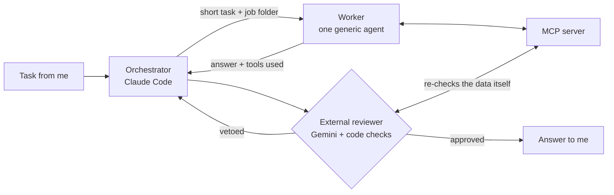

# Project 11 · An MCP server for the shop, and a test: do several agents beat one?

> ⚠️ **Fictional data.** It uses the same made-up orders and sales as [project 6](../06-sql-ventas/) and [project 9](../09-agente-telegram/).

## The problem
In [project 9](../09-agente-telegram/) the AI agent could look up orders, but only inside n8n: the tools were tied to that workflow. I wanted to understand **MCP (Model Context Protocol)**, the standard way to give an AI tools that any assistant can use. Think of it as an n8n node that the AI decides to use on its own.

Once the tools existed, a second question came up. Is it worth splitting the work between an **orchestrator and several workers**, checked by an **external reviewer**? Or does **one agent** do just as well?

## The solution
### Phase 1 · The shop's MCP server
A small server in TypeScript with three tools. Claude Code connects to it and uses them whenever a question needs them.

| Tool | What it does |
|---|---|
| `consultar_pedido` | Order status, products, whether it can still be returned, and the last day to ask for it |
| `buscar_ventas` | Sales totals (orders, units, net and gross amount, returned lines), with optional filters and grouped by product, size, currency or month |
| `iniciar_devolucion` | The only tool that **writes**. It records a return request as "requested" for a person to review. There is no automatic refund. |

**Safety:**
- Fictional data only.
- The two read tools open the databases read-only.
- The write tool only writes to its own file and never touches the data from projects 6 and 9.
- The business rules (30-day return window, valid statuses) are applied by code, not by the AI.
- Claude Code asks me for permission before every return.

### Phase 2 · Orchestrator, workers and an external reviewer

- **Few agents, well-built folders** (*context engineering*). There is only one worker agent. What changes is the folder of its job (`trabajadores/<puesto>/`): a short job description, the tools it may use, good and bad examples, and its lessons.
- **An external reviewer on a different model (Gemini).** It can veto but not edit. It re-checks every order and every sales query against the MCP itself. What can be measured (structure, order statuses) is checked by **code**, because Gemini proved unreliable at counting and at cross-checking long lists.
- **Lessons are only saved if the reviewer approves them**, and outdated lessons can be retired, with the reason kept in a history file.
- **Autonomy based on risk.** Internal, reversible work runs automatically. Anything that writes or goes outside the system always needs my approval.

## Results
| Test | Result |
|---|---|
| Reviewer exam (33 cases, half with deliberate mistakes, each run 3 times) | **100 %** of errors caught. The last full run had 4 % unfair vetoes; after fixing their cause, the affected cases passed 27/27 |
| Fair comparison (same knowledge, 5 multi-step tasks × 2 runs) | Orchestrator **10/10**, single agent **10/10** |
| Cost and time in that comparison | The orchestrator cost **~3×** more and took **~5×** longer |

**Conclusion: for these shop tasks, one agent is enough.** The orchestrator doesn't improve the quality. Its value is **auditability**: a log of every task, an external check before anything counts, and controlled lessons. That only matters when there is risk, and only if the reviewer really checks.

The full reports are in [`evaluacion/resultados/`](evaluacion/resultados/).

## Files
| Path | What it is |
|---|---|
| `src/servidor.ts` | The MCP server (three tools) |
| `orquestador/` | Phase 2: the orchestrator's rules (`CLAUDE.md`), the worker agent, job folders, the reviewer (`revisor/`) and its log (`registro/`) |
| `agente-unico/` | The single agent used as the control group |
| `evaluacion/` | The reviewer exam (`casos.ts`, `examinar-revisor.ts`), the comparisons (`comparar*.ts`, `rejuzgar.ts`), the code-check tests (`test-cruce.ts`) and all results |

## How to use it
Requires Node.js 24, which runs TypeScript directly and has a built-in SQLite reader. It also needs the fictional databases from projects 6 and 9, created with their own scripts.
```bash
npm install
npm run comprobar   # type check
npm start           # starts the server (Claude Code normally starts it by itself)
```
- **Use the server from Claude Code:** add it to a `.mcp.json` file like the one in `orquestador/`.
- **Phase 2:** open Claude Code inside `orquestador/` and give it a task. The reviewer needs a Gemini key in the `.env` file of [project 10](../10-examinador-agente/).
- **Run the reviewer exam:** `node evaluacion/examinar-revisor.ts 3`

## Known limitations
- The order-status and return rules are **copied** from project 9's API. A comment in the code warns about it, and both gave the same answer for all 1,392 orders.
- In an order range longer than 30, the reviewer only re-checks both ends.
- Each comparison is a small sample (10 runs per system). When both systems score 10/10, the test can't tell them apart.

## Why I built it this way
| Decision | Why | Trade-off |
|---|---|---|
| **TypeScript** instead of Python | It has an official MCP library, runs on the Node.js I already had, and let me practise JavaScript. | New syntax for me, compared with the Python I already knew. |
| **The server reads the databases directly** | It works on its own, without depending on project 9's API being switched on. | The business rules are copied from project 9. I checked that both give the same answer for all 1,392 orders. |
| **Read-only tools first, one write tool last** | I wanted to learn MCP without any risk of changing data. | The return tool came last and writes only to its own file. |
| **The orchestrator runs inside Claude Code** | It uses my subscription instead of a pay-per-use API. | Limits and logs are enforced by instructions and permissions, not by my own code. |
| **One generic worker plus job folders** | Few agents, well-built context: adding a job means adding a folder, not a new agent. | Claude Code can restrict tools per agent, not per job, so the reviewer checks that each job used only its tools. |
| **An external reviewer on a different model** | An AI isn't reliable when it reports on itself, as I saw in an earlier project. | Gemini is weak at counting and at cross-checking long lists, so measurable checks are done by code. |
| **Autonomy based on risk** | Internal, reversible work can be automatic; anything that writes or goes outside needs my approval. | Some tasks stop and wait for me. |
| **Limits of 4 workers and 15 steps per task** | Enough room to compare fairly with a single agent. | A higher cost per task than tighter limits. |

## What I learned
- **Code checks what can be measured; the AI judges the rest.** Gemini, used as the reviewer, missed things that a few lines of code catch every time.
- **The judge has to be tested too.** My first judge marked correct answers as wrong because my answer key was incomplete. Without checking, I would have concluded that the orchestrator was twice as good, and that was false.
- **More agents isn't automatically better.** I measured it fairly: same quality, at about 3× the cost.
- **Saving every answer** let me re-grade without running the test again, which saved usage.
